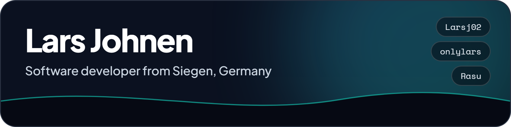
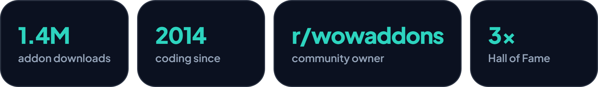
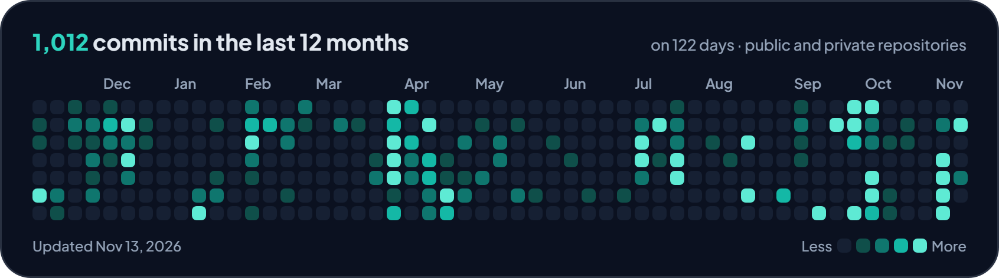

  

I have been programming since 2014, mostly self-taught, and I like building tools that other people actually use: World of Warcraft addons with more than a million downloads, and web applications for small businesses.

  

## Open source

| Project | What it does |
|---|---|
| [Legion Remix Helper](https://github.com/Larsj02/LegionRemixHelper) | Quality-of-life addon for WoW Legion Remix, 1.3M+ downloads |
| [Remix Gem Helper](https://github.com/Larsj02/Remix-Gem-Helper) | Gem management for Mists of Pandaria Remix, 133K+ downloads |
| [CF-API-Wrapper](https://github.com/Larsj02/CF-API-Wrapper) | TypeScript wrapper for the CurseForge API (`@larsj02/cf`) |

All my addons: [CurseForge](https://www.curseforge.com/members/larsj_02/projects)

## Activity

Most of my work lives in private repositories, so here is the full picture:

  

## What I work with

**Web:** TypeScript, Vue, Node.js, PHP (Symfony), SQL, Appwrite, Docker, Linux 
**Games:** Lua, the WoW addon API, WeakAuras, Java

## Elsewhere

[r/wowaddons](https://www.reddit.com/r/wowaddons/) · [CurseForge](https://www.curseforge.com/members/larsj_02/projects) · [LinkedIn](https://www.linkedin.com/in/lars-johnen/) · client work: [hybridlogic.tech](https://hybridlogic.tech)

The graphics are rendered by <a href="scripts/render.mjs">a small script</a> and refreshed daily by a GitHub Action.
